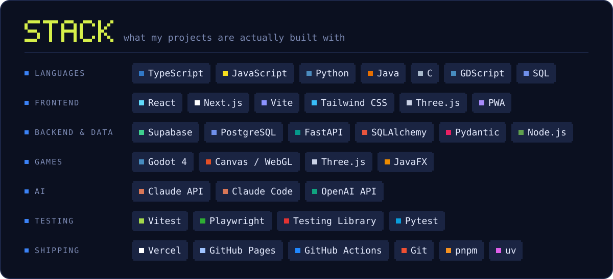
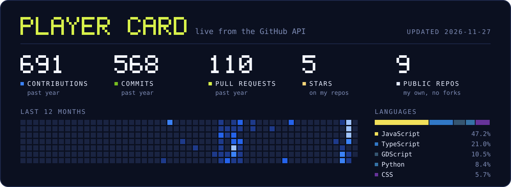

  

  

  <b>▶ PLAY</b>&nbsp;&nbsp;
  🎾 <a href="https://shawn01ee.github.io/pixel-tennis-open/">Pixel Tennis Open</a> ·
  🚋 <a href="https://ding-melbourne.vercel.app">DING! MELBOURNE</a> ·
  ⚔️ <a href="https://eclipse-blades.vercel.app">ECLIPSE BLADES</a> ·
  ✂️ <a href="https://shawn01ee.github.io/cut-and-dried/">Cut &amp; Dried</a>
   
  <b>▶ USE</b>&nbsp;&nbsp;
  🌡️ <a href="https://moiming.vercel.app">moiming</a> ·
  🐮 <a href="https://cash-cow-indol.vercel.app">CashCow</a> ·
  📅 <a href="https://smart-booking-system-lime.vercel.app">SmartBookingSystem</a>

  

  say hi → <a href="mailto:leesmofficial01@gmail.com">leesmofficial01@gmail.com</a>

